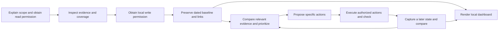

# Architecture: v0.1 development preview

## Components

- **Skill:** a shared method and focused references for collection, evidence, benchmarking, authorized actions, and follow-up.
- **Structured captures:** dated project context, sources, coverage, measures, findings, comparisons, actions, and typed links using stable identifiers.
- **Local helper:** validation, baseline initialization, later captures, integrity checking, dashboard rendering, and loopback serving.
- **Dashboard:** a derived read-only view with source evidence, graph navigation, audit filters, action state, and compatible history.

The agent investigates and reasons. The helper validates structure and stores curated records. The dashboard displays those records. None of these components establishes source authenticity or commercial causality automatically.

## Lifecycle

## Core invariants

Original captures are retained; follow-up does not replace the baseline. A failed or denied write must not leave a partial initialized project. Historical evidence remains distinguishable from current evidence. New capture timestamps advance, while metric windows describe the observations separately.

Unknown values remain null. Metrics are compared only when IDs, units, comparability definitions, and window durations agree. No percentage increase is inferred from a zero baseline. A completed task and a successful outcome are represented separately.

Project records and source material are treated as untrusted data. Dashboard values are escaped and inserted as text. The local server exposes dashboard files rather than the source evidence workspace. The UI cannot grant authorization.

## Deliberate initial limits

The first version uses a compact JSON record model instead of a database or hosted service. There is no autonomous collector, remote account synchronization, scheduling, multilingual UI, or marketplace installer. Connectors are used by the host agent when available; benchmark sources must be investigated rather than synthesized by the helper.

These limits keep the first pilot inspectable. Future work should be selected from observed failures and real user workflows, including native Claude Code and Codex runs, domain-specific evaluation sets, and a controlled real-project pilot.
